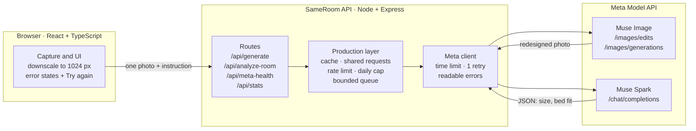
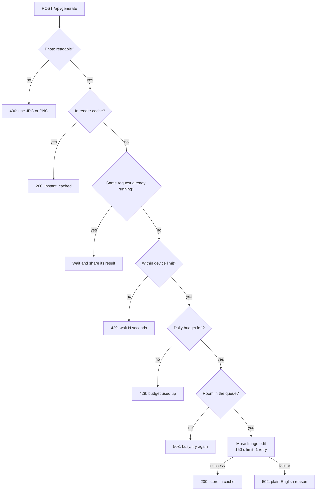
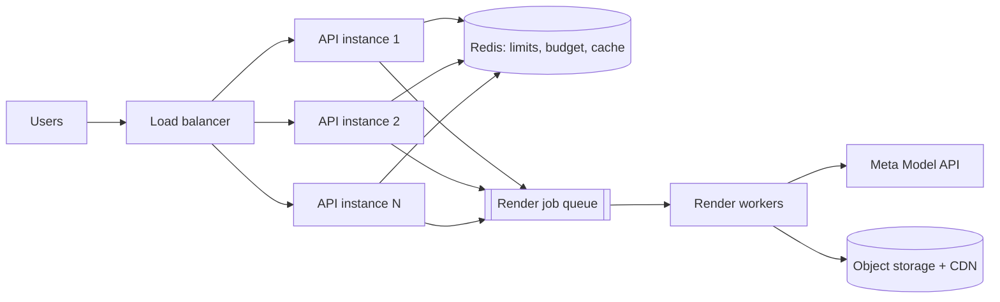

# SameRoom

**SameRoom turns one photo of your actual room into a photorealistic redesign of that same room, powered by Meta's Muse Image and Muse Spark, and it is engineered to stay fast, affordable and reliable under real traffic.**

1. **It redesigns your real space, not a stock room.**
2. **It understands the room it's redesigning.**
3. **It protects its own budget and capacity.**
4. **It fails clearly, never silently.**

---

## The data behind each claim

### 1. It redesigns your real space
- The core call is **Muse Image `POST /v1/images/edits`**, which edits the user's own photo rather than generating a new scene.
- Every request carries preservation rules: same camera angle, walls, ceiling height, window and door openings, and floor boundaries.
- Follow-up requests ("paint the wall sage", "add a wooden desk", "golden-hour light") are combined and **re-applied to the original photo**, so quality never degrades from editing an edit.
- Each style carries a 60-30-10 palette, materials and a lighting target, sent as a design manifest so the look stays consistent across camera angles.

### 2. It understands the room
- **Muse Spark `POST /v1/chat/completions`** receives the photo (text and image parts) and returns **structured JSON**: width, length, ceiling height, floor area, fit for single, double, queen and king beds, and recommended placement.
- It uses scale anchors visible in the photo: door height (~80″ / 2.0 m), switch plates (~48″) and ceiling corners. It runs at temperature 0.2 for stable output.
- Parsing tolerates code fences and surrounding chatter. Results are **labelled as estimates**, because a single photo has no true scale.

### 3. It protects its own budget and capacity
| Control | Default | Effect |
|---|---|---|
| Per-device rate limit (sliding window) | 40 renders · 20 analyses · 10 health checks per 10 min | One user can't drain the credits |
| Server-wide daily cap | 800 Meta calls per UTC day | A hard ceiling on spend, however many users arrive |
| Bounded concurrency | 4 image calls at once, 16 waiting | Bursts queue instead of stampeding Meta; overflow gets **503 "busy, try again"** |
| Render cache (LRU) | 64 MB, ≤ 500 entries | Repeat views are **instant and cost nothing** |
| Analysis cache | 4 MB | The same photo is never analysed twice |
| Shared in-flight requests | always on | Double-clicks and prefetches of the same design cost **one** call |
| Browser-side downscaling | longest edge 1024 px, JPEG quality 0.82, one photo per request | Uploads shrink from several MB to a few hundred KB |

Cache keys are a SHA-256 hash of *model + photo + full instruction*, so a cached result is only reused for exactly the same request. Cache hits never count against rate limits or the daily budget.

### 4. It fails clearly
- **Time limits:** 150 s per Meta call on the server, and 180 s per request in the browser.
- **Retry:** one automatic retry after 1.5 s on HTTP 429, 502–504 and network errors.
- **Error catalogue:** each failure maps to a plain-English reason shown in the app with a **Try again** button.

  | Cause | Shown as |
  |---|---|
  | 401 / 403 | bad API key |
  | 404 | wrong model name or URL |
  | 400 / 415 / 422 | rejected image or prompt |
  | 408 / 504 | timeout |
  | 429 | rate limit or credits |
  | 5xx | Meta server error |
  | unreadable photo | 400, "use JPG or PNG" |

- **Self-test:** `/api/meta-health?image=1&edit=1` checks the key, the text model, image generation and the photo-edit path (using a built-in generated test photo), and reports timings.
- **Live counters:** `/api/stats` shows renders, cache hits, shared duplicates, rate-limit hits, the daily budget, queue depth and average render time.
- **Verification:** during development the server was tested end to end against a simulated Meta API: **27 request scenarios** (photo formats and sizes, every makeover mode, eight failure types) and **15 production-layer checks** (cache, shared requests, limits, daily cap, queue). All passed.

---

## Architecture

### System view

### Life of a render request

Cheap checks run before expensive ones, so the only path that spends credits is the last one.

### Components
| Component | File | Responsibility |
|---|---|---|
| Frontend | `App.tsx` | Capture, downscaling, style and instruction UI, results, error states |
| API routes | `server.ts` | Input validation, building the instruction for each makeover mode |
| Production layer | `server.ts` | Cache, shared requests, rate limits, daily budget, bounded queue, stats |
| Meta client | `server.ts` | Plain `fetch` to the OpenAI-compatible endpoints; time limits, retry, error mapping |
| Observability | `server.ts` | Per-call timing logs, `/api/stats`, `/api/meta-health` |

### Design decisions
1. **Edit, don't generate.** Editing the real photo is what makes the result "my room". Generation is only the no-photo fallback.
2. **The key stays on the server.** The browser never calls Meta, which keeps the key safe and makes limits, caching and logging enforceable in one place.
3. **Re-apply to the original photo.** Combining instructions and editing the original avoids the quality loss of chained edits.
4. **Cheap checks first.** Cache, shared requests, limits, budget and queue are all checked before a single credit is spent.
5. **Backpressure over pile-ups.** A bounded queue with a clear 503 protects both the server and Meta's rate limits during bursts.
6. **Fail loud.** A failure is shown with its reason. A spinner that never ends is treated as a bug.
7. **Plain `fetch`, no SDK.** The API is OpenAI-compatible, so one fewer dependency.
8. **In memory for now, on purpose.** One instance needs no external services. The move to Redis is planned below.

### Scaling to many users

1. The API tier is already stateless apart from in-memory limits and caches. Move those to **Redis** and run N instances behind a **load balancer**.
2. Renders become **jobs**: the API returns a job ID immediately, workers call Meta, and the browser polls. This removes gateway timeouts entirely.
3. Finished renders go to **object storage behind a CDN** instead of base64 responses.
4. Quotas move from devices to **user accounts**.

Cost scales with Meta calls, and every cache hit or shared request is a call that isn't paid for twice. `/api/stats` shows that ratio live.

### Known limits
- Limits and caches protect a **single instance** until they move to Redis.
- Behind some proxies all users can appear to share one address, which turns the per-device limit into a shared one. If that happens, raise `RATE_LIMIT_RENDERS`.
- Room dimensions are **estimates** from one photo, not measurements.
- Consistency across camera angles relies on the shared design manifest. Image-reference matching is on the roadmap.

---

## Configuration
| Variable | Default | Purpose |
|---|---|---|
| `META_API_KEY` | (required) | Meta Model API key |
| `META_BASE_URL` | `https://api.meta.ai/v1` | API base URL |
| `META_TEXT_MODEL` / `META_IMAGE_MODEL` | `muse-spark-1.3` / `muse-image-1.0` | Model names |
| `META_TIMEOUT_MS` | `150000` | Time limit per Meta call |
| `META_MAX_CONCURRENCY` / `META_MAX_QUEUE` | `4` / `16` | Image calls at once / allowed to wait |
| `RATE_WINDOW_SECONDS` | `600` | Rate-limit window |
| `RATE_LIMIT_RENDERS` / `RATE_LIMIT_ANALYSES` / `RATE_LIMIT_HEALTH` | `40` / `20` / `10` | Per-device limits per window |
| `DAILY_META_CALL_CAP` | `800` | Meta calls per UTC day |
| `CACHE_MAX_MB` | `64` | Render cache size |

## Run it
Requires Node.js 18+ and a Meta Model API key. Run `npm install`, set `META_API_KEY`, then `npm run dev` (script names may differ slightly in `package.json`). Once it's running, open `/api/meta-health?image=1&edit=1` and `/api/stats`.

## Roadmap
SAM 3.1 surface masks for per-surface edits · image-reference consistency across angles · Redis-backed limits and cache · render job queue with workers · account-based quotas.
