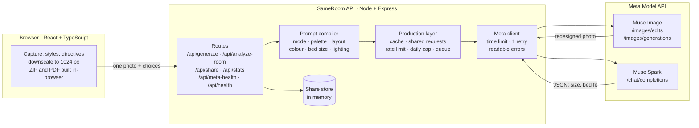
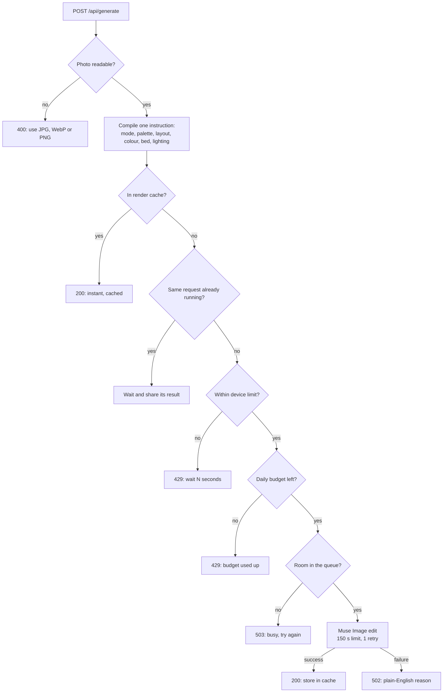
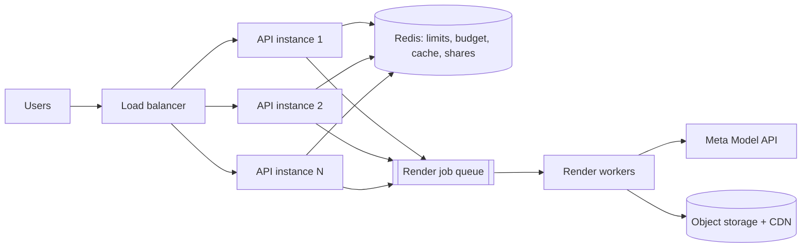

# SameRoom

**SameRoom turns a photo of your actual room, house or courtyard into a photorealistic redesign of that same space, powered by Meta's Muse Image and Muse Spark, and it hands you a plan you can shop from, export and share, on a backend built to hold up under real traffic.**

1. **It redesigns your real space, indoors and out.**
2. **You direct it like a designer.**
3. **It understands the room.**
4. **It hands you a plan you can use and share.**
5. **It protects its budget and capacity.**
6. **It fails clearly, never silently.**

---

## The data behind each claim

### 1. It redesigns your real space, indoors and out
- **Muse Image `POST /v1/images/edits`** edits the user's own photo in place rather than generating a new scene. Every request carries preservation rules: walls, windows, door frames and perspective for interiors, and building massing, rooflines and boundary walls for exteriors.
- **19 designer styles:**
  - **Interior (15):** Japandi, Industrial Modern, Mid-Century Modern, Biophilic, Luxury Contemporary, Bohemian Chic, Pure Minimalist, Warm Scandinavian, Coastal Hampton, Modern Farmhouse, Art Deco Glam, Transitional, Warm Mediterranean, Vibrant Maximalist and Parisian Haussmann.
  - **Exterior and landscape (4):** Indian Courtyard & Haveli, Modern Indian Villa Exterior, Tropical Garden & Landscape, and Mediterranean Garden & Terrace.
- **13 space types:**
  - **Interior (7):** living room, bedroom, kitchen, dining room, home office, bathroom and studio.
  - **Exterior (6):** garden & landscape, house exterior / facade, **Indian courtyard (aangan)**, **verandah / thinnai**, rooftop terrace garden, and balcony / patio.
- **5 makeover modes:** Paint & Colours Only (furniture untouched), Architectural Restyle, Declutter & Polish, Virtual Staging and Custom Vision. Each has its own exterior variant.

### 2. You direct it like a designer
- **14 one-tap additions:**
  - **Indoor:** fridge, L-shaped sectional, kitchen island, dining table, wall-mounted TV and desk.
  - **Outdoor:** teak jhula swing, terracotta jali screens, brass urli, timber pergola, champa trees, garden path lights, CNC louvers and a fire pit.
- **Layout instructions** in plain words ("fridge in the left corner, sofa facing the window") are woven into every render.
- **Tweak with Meta AI** accepts voice or text, remembers earlier requests and re-applies them all to the original photo. It also offers **6 one-tap wall colours** and a **bed-size selector** (single, double, queen, king in Indian sizes).
- **Time-of-day lighting:** Golden Hour (~2800 K), Bright Noon (~5500 K) and Blue Hour (twilight), previewed live and optionally applied to the next render.
- **Finding a style:** a style catalog with interior/exterior filters, full-text search across style names, paint names, paint codes, materials and lighting, and 18 quick filter chips.

### 3. It understands the room
- **Muse Spark `POST /v1/chat/completions`** reads the photo (text and image) and returns structured JSON: width, length, ceiling height, floor area, fit for single, double, queen and king beds, and recommended placement.
- It uses scale anchors visible in the photo (door height, switch plates, ceiling corners), runs at temperature 0.2, and is cached per photo. Results are labelled as **estimates**.

### 4. It hands you a plan you can use and share
- **Spec sheet:** a 60-30-10 palette with copyable paint codes, Kelvin lighting targets, fixture advice and clearance rules.
- **Tag-to-shopping-list:** pin items on the render with category, dimensions, cost and status (wishlist, sourcing or purchased), then copy the list.
- **ZIP design pack:** up to 4 angle images plus the overview render, `palette-60-30-10.json`, `shopping-list.json`, `shopping-list.txt` and a readme.
- **PDF design dossier:** palettes, lighting, clearances and the tagged shopping table.
- **Shareable links:** a share modal creates a link (`?share=<id>`) that opens the shared design (style, room type and render) for anyone. Style deep links (`?style=…&room=…`) work too, along with native share of the image file.
- **Favourites** are saved on the device.

### 5. It protects its budget and capacity
| Control | Default | Effect |
|---|---|---|
| Per-device rate limit (sliding window) | 40 renders · 20 analyses · 10 health checks per 10 min | One user can't drain the credits |
| Server-wide daily cap | 800 Meta calls per UTC day | A hard ceiling on spend |
| Bounded concurrency | 4 image calls at once, 16 waiting | Bursts queue; overflow gets **503 "busy, try again"** |
| Render cache (LRU) | 64 MB, ≤ 500 entries | Repeat requests are instant and free |
| Analysis cache | 4 MB | The same photo is never analysed twice |
| Shared in-flight photo edits | always on | Identical simultaneous requests cost **one** call |
| Browser-side downscaling | 1024 px, JPEG quality 0.82, one photo per request | Uploads of a few hundred KB instead of several MB |

Cache keys are a SHA-256 hash of *model + photo + full instruction*. Cache hits never count against limits or the budget.

### 6. It fails clearly
- **Time limits:** 150 s per Meta call on the server, and 180 s per request in the browser.
- **Retry:** one automatic retry after 1.5 s on HTTP 429, 502–504 and network errors.
- **Error catalogue:** every failure becomes a plain-English reason shown in the app with a **Try again** button.

  | Cause | Shown as |
  |---|---|
  | 401 / 403 | bad API key |
  | 404 | wrong model or URL |
  | 400 / 415 / 422 | rejected image or instruction |
  | 408 / 504 | timeout |
  | 429 | rate limit or credits |
  | 5xx | Meta server error |
  | unreadable photo | 400 |

- **Format detection:** the server checks the actual format of each returned image (PNG, JPEG or WebP), so the browser always receives a valid image.
- **Self-test and counters:**
  - `/api/meta-health?image=1&edit=1` checks the key, the text model, image generation and the photo-edit path (using a built-in test photo), with timings.
  - `/api/stats` gives live counters.
  - `/api/health` is a basic liveness check.
- **Verification:** during development the reliability and production layers were tested end to end against a simulated Meta API, with **27 request scenarios** and **15 production-layer checks**. All passed.

---

## Feature list

**Capture**
- Camera multi-snap (up to 4 angles), photo upload, and video-pan frame extraction (4 frames).
- One-click demos for an interior living room and an Indian courtyard.

**Design**
- 19 styles across 13 space types, with 5 makeover modes.
- A style catalog with interior and exterior filters.
- Search and 18 filter chips.

**Direct**
- 14 one-tap furniture and landscape additions, plus free-text layout instructions.
- Voice or text tweaks with memory.
- Colour swatches, bed sizes and time-of-day lighting.

**Understand**
- Room dimensions and a bed-fit estimate from Muse Spark.

**Compare**
- Before/after split slider.
- Overview, per-angle and grid views.
- A 3D tilt preview, updated directly on the page without re-rendering the app.

**Plan**
- 60-30-10 spec sheet and tag-to-shopping-list.
- PDF dossier and ZIP design pack.

**Share**
- Shareable links, style deep links and native image share.
- Favourites.

**Run**
- Rate limits, daily budget, caches, shared requests and a bounded queue.
- Readable errors, a live loading timer, health checks and stats.

---

## Architecture

### System view

### Life of a render request

Cheap checks run before expensive ones, so only the last step spends credits.

### Components
| Component | File | Responsibility |
|---|---|---|
| Frontend | `App.tsx` | Capture, downscaling, styles, directives, results, exports (ZIP via JSZip, PDF via jsPDF), errors |
| Share UI | `components/ShareModal` | Creating and copying shareable links |
| API routes | `server.ts` | Validation, compiling the instruction for each mode (interior or exterior) |
| Production layer | `server.ts` | Cache, shared requests, rate limits, daily budget, bounded queue, stats |
| Meta client | `server.ts` | Plain `fetch` to the OpenAI-compatible endpoints; time limits, retry, error mapping, image format detection |
| Share store | `server.ts` | In-memory store of the latest 300 shared designs |

### Design decisions
1. **Edit, don't generate.** Editing the real photo is what makes it "my room". Generation is only the no-photo fallback.
2. **One compiled instruction.** Mode, palette, layout, colour, bed size and lighting are merged into one short instruction, which keeps requests small and makes them cacheable.
3. **The key stays on the server.** The browser never calls Meta, so limits, caching and logging are enforced in one place.
4. **Cheap checks first.** Nothing spends credits until cache, shared requests, limits, budget and queue have all passed.
5. **Backpressure over pile-ups.** A bounded queue with a clear 503 protects the server and Meta's rate limits.
6. **Fail loud.** Every failure is shown with its reason.
7. **Exports run in the browser.** ZIP and PDF are built on the device, with no server cost and no upload.
8. **In memory for now, on purpose.** One instance needs no external services. The Redis path is below.

### Scaling to many users

1. **Shared state to Redis:** move limits, budget, caches and shared designs to Redis, then run N API instances behind a load balancer.
2. **Renders as jobs:** the API returns a job ID immediately, workers call Meta, and the browser polls. This removes gateway timeouts.
3. **Images to storage:** keep images in object storage behind a CDN. Share links then hold only a reference, not the image.
4. **Account quotas:** move quotas from devices to user accounts.

### Known limits
- Limits, caches and shared links live in memory on **one instance**. Shared links are lost on restart and include the image data.
- Behind some proxies all users can appear to share one address, which makes the per-device limit act like a shared one.
- Room dimensions are **estimates** from one photo.
- Separate renders of different camera angles are not forced to match each other.

---

## Configuration
| Variable | Default | Purpose |
|---|---|---|
| `META_API_KEY` | (required) | Meta Model API key |
| `META_BASE_URL` | `https://api.meta.ai/v1` | API base URL |
| `META_TEXT_MODEL` / `META_IMAGE_MODEL` | `muse-spark-1.3` / `muse-image-1.0` | Model names |
| `META_TIMEOUT_MS` | `150000` | Time limit per Meta call |
| `META_MAX_CONCURRENCY` / `META_MAX_QUEUE` | `4` / `16` | Image calls at once / allowed to wait |
| `RATE_WINDOW_SECONDS` | `600` | Rate-limit window |
| `RATE_LIMIT_RENDERS` / `RATE_LIMIT_ANALYSES` / `RATE_LIMIT_HEALTH` | `40` / `20` / `10` | Per-device limits per window |
| `DAILY_META_CALL_CAP` | `800` | Meta calls per UTC day |
| `CACHE_MAX_MB` | `64` | Render cache size |
| `PORT` / `HOST` | `3000` / `0.0.0.0` | Server address (also `--port` / `--host`) |

## Run it
Requires Node.js 18+ and a Meta Model API key. Run `npm install`, set `META_API_KEY`, then `npm run dev`. Once it's running, open `/api/meta-health?image=1&edit=1` and `/api/stats`.

## Roadmap
SAM 3.1 surface masks for per-surface edits · matching across camera angles  cache and shares · render job queue with workers · account-based quotas.
